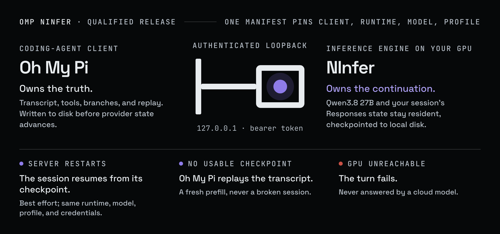
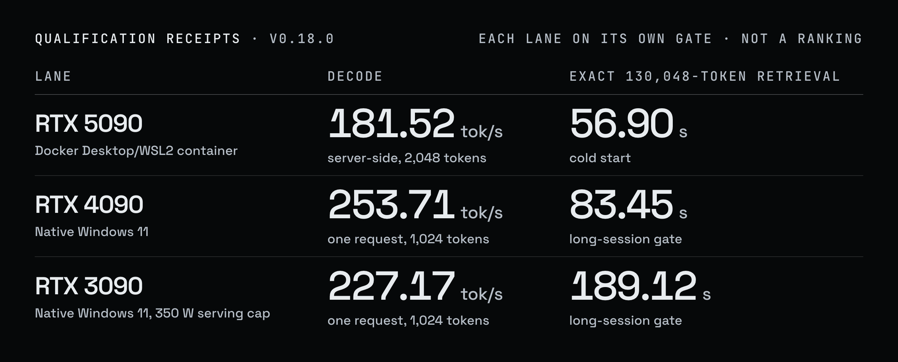

[](https://github.com/alphastorm/omp-ninfer/blob/v0.16.2/docs/QUICKSTART.md)

<div align="center">

[Oh My Pi](https://github.com/can1357/oh-my-pi) is the coding agent. [NInfer](https://github.com/Neroued/ninfer)
keeps your session's continuation state resident on your GPU. **OMP NInfer** is the qualified release
that binds them with one hash-pinned Qwen3.8 27B model on an RTX 5090, 4090, or 3090 you own.

Every install route in the published guide was run end to end on **v0.16.2** with unmodified
[Oh My Pi 18.15.0](https://github.com/can1357/oh-my-pi/releases/tag/v18.15.0) — 31 steps,
three client platforms, both native lanes
([receipt](releases/v0.16.2/acceptance/composed-external-installation.json)).

### [Get started →](https://github.com/alphastorm/omp-ninfer/blob/v0.16.2/docs/QUICKSTART.md)

[![CI][ci-badge]][ci] [![Release][release-badge]][releases] [![RTX 5090 decode][decode-badge]][benchmarks] [![Context][context-badge]][benchmarks] [![License][license-badge]][license]

[Download v0.16.2](https://github.com/alphastorm/omp-ninfer/releases/tag/v0.16.2) · [Lanes](https://github.com/alphastorm/omp-ninfer/blob/v0.16.2/docs/QUICKSTART.md#choose-your-lane) ·
[Facts](docs/FACTS.md) · [Compare](docs/DECISION_GUIDE.md) · [Benchmarks](docs/BENCHMARKS.md) ·
[Architecture](docs/ARCHITECTURE.md) · [Security](docs/SECURITY.md) · [Troubleshooting](docs/TROUBLESHOOTING.md) ·
[Roadmap](ROADMAP.md) · [Changelog](CHANGELOG.md)

</div>

[Contributor acceptance and doctor](docs/QUICKSTART.md#contributor-acceptance-and-preflight) run without GPU hardware in rehearsal/offline mode; rehearsal receipts never qualify a release.

[ci]: https://github.com/alphastorm/omp-ninfer/actions/workflows/ci.yml
[ci-badge]: https://img.shields.io/github/actions/workflow/status/alphastorm/omp-ninfer/ci.yml?branch=main&label=CI&labelColor=0B0E11
[releases]: https://github.com/alphastorm/omp-ninfer/releases
[release-badge]: https://img.shields.io/github/v/release/alphastorm/omp-ninfer?filter=v*&label=release&color=8E7BE8&labelColor=0B0E11
[benchmarks]: docs/BENCHMARKS.md
[decode-badge]: https://img.shields.io/badge/RTX%205090%20decode-182.02%20tok%2Fs-8E7BE8?labelColor=0B0E11
[context-badge]: https://img.shields.io/badge/context-130%2C048%20tokens%20exact-1C232B?labelColor=0B0E11
[license]: LICENSE
[license-badge]: https://img.shields.io/github/license/alphastorm/omp-ninfer?color=1C232B&labelColor=0B0E11

## What it does

A long coding session is 100K tokens of transcript, thinking, tool calls, and images. Sent to a
cloud provider, every token is metered and every file leaves your machine. Sent to a stateless
local server, every turn re-sends the whole transcript. A live NInfer, llama.cpp, or vLLM process
already avoids recomputing an unchanged prefix while it stays up; that is prior art, and this
project does not claim it. What OMP NInfer adds is continuation you can rely on:

- **Explicit and durable.** Oh My Pi drives NInfer through stateful OpenAI Responses
  (`previous_response_id`); forks and rollback are qualified, and checkpoints restore after a server
  restart. Oh My Pi commits the transcript first, so losing retained state degrades to a replay,
  never a broken session.
- **Private and fail-closed.** Both endpoints bind loopback only, every request is
  bearer-authenticated, and model fallback is off: an unreachable GPU fails the turn instead of
  answering from a cloud model. This is acceptance-tested, not configured.
- **Exact and verifiable.** Model SHA-256, container digest and SBOM, native package and client
  checksums, and every qualification receipt are bound in one manifest;
  `python3 scripts/verify_release.py --require-ready` proves your clone is the qualified release.

<div align="center">


<sub>Recorded on v0.14.0 (RTX 5090): LRU bug fixed, tests green, ninfer-serve restarted
mid-session, follow-up answered reusing 10,375 retained prompt tokens. 32 s, idle gaps and the
36 s reload compressed · <a href="docs/media/omp-ninfer-demo-v14.mp4">MP4</a> · <a href="docs/media/README.md#canonical-files">provenance</a></sub>

</div>

## Is it for you

**Use OMP NInfer when** you run Oh My Pi, own an RTX 5090, 4090, or 3090 on Windows 11, want
Qwen3.8 27B, and care about long private sessions that survive a server restart.

**Use something else when** you want a broad model catalog ([Ollama](https://ollama.com)), a
desktop GUI ([LM Studio](https://lmstudio.ai)), the widest hardware reach or Apple silicon
([llama.cpp](https://github.com/ggml-org/llama.cpp)), or multi-user throughput
([vLLM](https://github.com/vllm-project/vllm)). Candid comparison: [decision guide](docs/DECISION_GUIDE.md).

## Qualified lanes

| Lane | Host and client | What you get | Measured |
| --- | --- | --- | --- |
| **RTX 5090** | Windows 11 + Docker Desktop/WSL2 container; Windows client local, macOS over a manual SSH tunnel (preview), Linux client under WSL2 | 131,072-token context, two requests in flight, DFlash2 draft window 7, JSON-schema output, vision + tools + preserved thinking | 182.02 tok/s decode (180.50 tok/s wall); exact 130,048-token retrieval in 56.49 s cold (56.38 s server prefill) ([receipt](releases/v0.16.2/qualification/rtx5090.json)) |
| **RTX 4090** | Native Windows 11 package; Windows client local | 131,072-token context, one request at a time, DFlash2 draft window 7, JSON-schema output, text + tools | 254.59 tok/s C1 decode; exact 130,048-token retrieval in 83.54 s ([receipt](releases/v0.16.2/qualification/rtx4090.json)) |
| **RTX 3090** | Native Windows 11 package; Windows client local | 131,072-token context, two requests in flight (shared 131,072-token pool), DFlash2 draft window 7, 350 W serving cap, JSON-schema output, text + tools | 148.70 tok/s C1 decode; exact 130,048-token retrieval in 188.94 s ([receipt](releases/v0.16.2/qualification/rtx3090.json)) |

Both native lanes install on one two-GPU host, each bound to its GPU UUID, and run one at a time on
port 18082; all three lanes serve the same 20.4 GB Qwen3.8 27B model container version 3 artifact
(`81f924d4`). Checkpoints are best effort and restore only on the same runtime, model, profile, and
credentials. Exact component, source, and model identities: [facts](docs/FACTS.md#current-release) ·
[glossary](docs/FACTS.md#glossary) · [manifest](releases/v0.16.2/manifest.json).

## Get started

1. **[Choose your lane](https://github.com/alphastorm/omp-ninfer/blob/v0.16.2/docs/QUICKSTART.md#choose-your-lane)** and check its prerequisites.
2. **Clone tag `v0.16.2`** and run `python3 scripts/verify_release.py --require-ready`.
3. **[Install the stock Oh My Pi 18.15.0 client](https://github.com/alphastorm/omp-ninfer/blob/v0.16.2/docs/QUICKSTART.md#omp-18150-client)** with the
   fail-closed config and per-model fragment.
4. **Run the acceptance checks** at the end of your lane's route: tool turn, continuation, restart
   survival, fail closed.

Upgrading from `v0.16.0` (the held `v0.16.1` client-only candidate was not published) updates the
unmodified upstream Oh My Pi client to **18.15.0** (`3fedf8d5`, tree `48bc72ba`, release `430630500`;
retaining Qwen's exact-loop guard with a 1,024-character floor on short newline-spanning cycles and
rejecting incomplete length-stopped summaries while retiring obsolete operator
`compat.thinkingLoopGuard`, stripping only `internal_chat_message_metadata_passthrough` on shared
Responses replay copies, gating the new missing-key fallback behind explicit
`retry.modelFallback=false`, and waiting for persistence replacement on manual compaction before
delivering queued background results;
[18.14.2 review](docs/measurements/2026-11-01-omp-18142-client-upgrade-review.json) ·
[18.15.0 review](docs/measurements/2026-11-01-omp-18150-client-upgrade-review.json)), keeps the
shared published model container version 3 (`qwen3_8_27b-v3.ninfer`, `81f924d4`), and rebuilds all
three GPU lanes at common engine source `a87de361` (`a87de3613c17bced777b446fb545f872d8395ec1`) on
upstream `Neroued/ninfer` master `64d10fbf` with byte-proven durable-generation Host reclaim and
the [managed-Stop capacity fix #78](https://github.com/alphastorm/ninfer/issues/78),
export-retirement reservation, opt-in FP32 head identity alignment, deterministic bounded
relocatable-device-code (RDC) builds, and native repair/power/gate-driver fixes: RTX 5090 container
`v0.7.0-qwen38-5090-beta.5`
(image `a0cbb8a5` on base `28857182`, server `cc99a460`, kept profile `qwen38-5090-v0.13.0`,
checkpoint directory `checkpoints-v013`, bit-identical 661-artifact / 3-package same-path double
build), native Windows RTX 4090 `v0.8.0-qwen38-4090-beta.2` (package `d9b10b47`, server `ffee91bf`,
profile `qwen38-4090-native-v0.8.0-beta.2`, config `ae27dc44`, DFlash2 `K=7`, INT8 KV, `C1`,
`1,024`-token prefill chunk), and native Windows RTX 3090 `v0.8.0-qwen38-3090-beta.2` (package
`97a8e634`, server `15a4db46`, profile `qwen38-3090-native-v0.8.0-beta.2`, config `238ccad7`,
DFlash2 `K=7`, INT8 KV, `C2` over one shared 131,072-token pool, `ninfer-native-3090: 2` in
[`examples/manual-tunnel/fail-closed.yml`](examples/manual-tunnel/fail-closed.yml), 350 W serving
cap). Stop an existing `v0.16.0` RTX 5090 container with the `v0.16.0` stop script before starting
`beta.5`; running native lanes upgrade directly through `Install-Release.ps1` and preserve the
incumbent for `Control-Release.ps1 -Action Rollback` (3/3 running-upgrade, forced-rollback, and
repair rehearsals passed on both lanes, with RTX 4090 using a founder-approved private harness copy
changing only uncapped-power assertions). Keep prior checkpoint roots untouched and replay
authoritative OMP transcripts for a fresh prefill. Native no-regression speed gates against
published `beta.1` pass at weighted **1.0003 / 0.9996**, minimum **0.9988 / 0.9989**, with **84/84
/ 115/115** byte-identical normalized outputs (RTX 3090 / RTX 4090) under the explicit founder rule
(weighted `>= 0.98`, every case `>= 0.95`, superseding the earlier `1.08` floor); three exact
founder parity waivers (`restore_0` on RTX 5090, `restore_1` on RTX 4090, sibling position 1 `base`
on RTX 3090) and RTX 3090's failed post-route native campaign at structured-outage managed Stop
(`graceful_incomplete_shutdown`, saved `1` / skipped `8` / refused `1`, reason `capacity`,
reclaimed `0`, founder-waived with empty-session `Control-Release.ps1 -Action Start` then `-Action
Stop` recovery; no RTX 3090 behavior completion, wrapper restoration audit pass, or anonymous
public-install claim; follow-ups in fork [#87](https://github.com/alphastorm/ninfer/issues/87)–[#90](https://github.com/alphastorm/ninfer/issues/90)
and [#138](https://github.com/alphastorm/omp-ninfer/issues/138)) are bound in the
[release notes](releases/v0.16.2/NINFER_RELEASE_NOTES.md). Native owners staying on `v0.10.0` keep
the [v0.10.0 guide](https://github.com/alphastorm/omp-ninfer/blob/v0.10.0/docs/QUICKSTART.md).

**Next on main: v0.17.0** binds RTX 5090 beta.6 from F3 `e0971faf`, stock OMP **18.18.6**
and unchanged native beta.2 packages. Fresh candidate `076bbe4f` passed all five documented
routes (**31/31 blocks**) and three stock clients; the RTX 5090 hold was **408.213 s** and
RTX 4090 native campaign/public install/restoration passed. RTX 3090's route passed, but its later
native-probes compaction campaign failed and was specifically waived by the founder with disclosure;
structured outage, a passing wrapper audit and anonymous public install are not claimed.
RTX 3090 users should keep v0.16.2 or restart the lane after long sessions until a native re-cut
is qualified. See the [successor notes](releases/v0.17.0/NINFER_RELEASE_NOTES.md) and
[versioned guide](docs/QUICKSTART.md). Product publication and production promotion are
founder-only; the published install authority stays v0.16.2.

## How it works



Oh My Pi (coding-agent client) → OMP NInfer (qualified appliance and release layer) → NInfer
(inference engine) → Qwen3.8 27B (served model).

- **Oh My Pi owns the truth.** Transcript, tools, branches, and replay. A turn advances provider
  state only after a complete stream and a durable transcript write.
- **NInfer owns inference and retained state.** The C++/CUDA engine from
  [Neroued/ninfer](https://github.com/Neroued/ninfer) and its GPU ports, plus this project's
  explicit Responses state and checkpoints. Retained state accelerates; it is never the source of truth.
- **The manifest owns identity.** [`releases/v0.16.2/manifest.json`](releases/v0.16.2/manifest.json)
  binds client, runtime, model, profile, and receipts; `ready` requires composed external acceptance.

[Architecture](docs/ARCHITECTURE.md) · [Security model](docs/SECURITY.md) ·
[Release lifecycle](docs/RELEASES.md)

## Measured, not estimated



Each lane is measured on its own gate, machine, and profile; the strip is not a ranking. Method,
per-lane charts, the warm-versus-cold boundary rules, model quality, and the community table:
[benchmarks](docs/BENCHMARKS.md).

## Release integrity

```sh
python3 scripts/verify_release.py --require-ready
python3 -m unittest discover -s tests -v
```

Both pass on a tagged release. A `ready` manifest binds the upstream Oh My Pi binaries,
compatibility matrix, container digest and SBOM or native package checksums, lane-specific model
SHA-256, per-lane qualification receipts, and owner-operated acceptance of every documented route.
Lifecycle and cut rules: [releases](docs/RELEASES.md).

## Documentation

| Document | What it answers |
| --- | --- |
| [Quickstart](docs/QUICKSTART.md) | Which lane, prerequisites, exact install, acceptance checks |
| [Facts](docs/FACTS.md) | Current identities, limits, and non-claims in one place |
| [Decision guide](docs/DECISION_GUIDE.md) | This versus Ollama, LM Studio, llama.cpp, vLLM |
| [Compatibility](docs/COMPATIBILITY.md) | Qualified client and runtime combinations (generated) |
| [Architecture](docs/ARCHITECTURE.md) | State ownership, loopback topology, identity chain |
| [Benchmarks](docs/BENCHMARKS.md) | Receipts, method, charts, model quality, community results |
| [Performance](docs/PERFORMANCE.md) | Kernel and schedule experiment ledger (`EXP-001`..`EXP-107`) |
| [Security](docs/SECURITY.md) | Threat model and boundaries |
| [Troubleshooting](docs/TROUBLESHOOTING.md) | Failure signatures and recovery |
| [Related work](docs/RELATED_WORK.md) | Prior art and the NInfer port family |
| [Upstream](docs/UPSTREAM.md) | Upstream watch and fork points |
| [Releases](docs/RELEASES.md) | Version history and how a release is cut |
| [Roadmap](ROADMAP.md) | Remaining work and explicit non-promises |
| [Changelog](CHANGELOG.md) | What changed, per release |
| [Media provenance](docs/media/README.md) | Checksums and capture notes for every recording |

## Help make it better

- **Ran a clean install?** Report
  [time-to-first-turn and every manual step](https://github.com/alphastorm/omp-ninfer/issues/new?template=clean-install-report.yml);
  install friction is a bug.
- **Measured your card?** Submit the
  [performance result form](https://github.com/alphastorm/omp-ninfer/issues/new?template=benchmark-report.yml)
  after the acceptance checks pass.
- **Work on CUDA kernels?** Pick a bottleneck from the [performance program](docs/PERFORMANCE.md)
  and send before/after receipts.
- **Need another model or profile?** File a
  [model/profile request](https://github.com/alphastorm/omp-ninfer/issues/new?template=model-profile-request.yml).

Routing rules: [CONTRIBUTING.md](CONTRIBUTING.md). Strip keys, hostnames, prompts, outputs, and raw
logs before filing. Support covers `v0.16.2` and its exact profiles for a single local owner; no SLA.
Vulnerabilities: [private reporting](SECURITY.md), never a public issue.

## Credits

- **[Oh My Pi](https://github.com/can1357/oh-my-pi)** by [can1357](https://x.com/_can1357), built
  on [Pi](https://github.com/badlogic/pi-mono) by Mario Zechner (MIT). The coding agent this
  appliance serves; since v0.8.0 the client is the unmodified upstream binary and this project
  publishes no client.
- **[NInfer](https://github.com/Neroued/ninfer)** by Neroued (Apache-2.0). The C++/CUDA engine,
  `.ninfer` format, MTP and DFlash2 speculative decoding, and evaluation campaigns. Public runtime
  source for all three lanes: [alphastorm/ninfer](https://github.com/alphastorm/ninfer).
- **The Qwen team** (Apache-2.0). Qwen3.8 27B, served from the registered conversions at
  [neroued/Qwen3.8-27B-NInfer](https://huggingface.co/neroued/Qwen3.8-27B-NInfer).
- **[UDPSendToFailed/ninfer-4090](https://github.com/UDPSendToFailed/ninfer-4090)** and
  **[Don-Chad/ninfer-3090](https://github.com/Don-Chad/ninfer-3090)** (Apache-2.0). The RTX 4090 and
  RTX 3090 ports the native lanes build on.
- Gated DeltaNet ([arXiv: 2412.06464](https://arxiv.org/abs/2412.06464)), Tri Dao's ReplaySSM note,
  Z-Lab's DFlash, Unsloth's NVFP4 weights, and vendored `utf8proc`, `nlohmann/json`, and
  `cpp-httplib`; tracked in [upstream](docs/UPSTREAM.md).

Community project; not affiliated with or endorsed by Oh My Pi, Qwen, or NVIDIA.

## License

MIT. NInfer and the Qwen artifacts retain their own licenses and notices.
