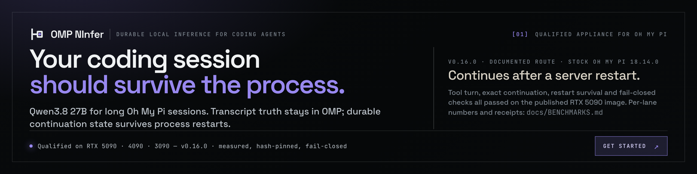

[](docs/QUICKSTART.md)

<div align="center">

[Oh My Pi](https://github.com/can1357/oh-my-pi) is the coding agent. [NInfer](https://github.com/Neroued/ninfer)
keeps your session's continuation state resident on your GPU. **OMP NInfer** is the qualified release
that binds them with one hash-pinned Qwen3.8 27B model on an RTX 5090, 4090, or 3090 you own.

Every install route in the guide was run end to end on **v0.17.0** with unmodified
[Oh My Pi 18.18.6](https://github.com/can1357/oh-my-pi/releases/tag/v18.18.6) — 31 steps,
three client platforms, both native lanes
([receipt](releases/v0.17.0/acceptance/composed-external-installation.json)).

### [Get started →](docs/QUICKSTART.md)

[![CI][ci-badge]][ci] [![Release][release-badge]][releases] [![RTX 5090 decode][decode-badge]][benchmarks] [![Context][context-badge]][benchmarks] [![License][license-badge]][license]

[Download v0.17.0](https://github.com/alphastorm/omp-ninfer/releases/tag/v0.17.0) · [Lanes](docs/QUICKSTART.md#choose-your-lane) ·
[Facts](docs/FACTS.md) · [Compare](docs/DECISION_GUIDE.md) · [Benchmarks](docs/BENCHMARKS.md) ·
[Architecture](docs/ARCHITECTURE.md) · [Security](docs/SECURITY.md) · [Troubleshooting](docs/TROUBLESHOOTING.md) ·
[Roadmap](ROADMAP.md) · [Changelog](CHANGELOG.md)

</div>

[ci]: https://github.com/alphastorm/omp-ninfer/actions/workflows/ci.yml
[ci-badge]: https://img.shields.io/github/actions/workflow/status/alphastorm/omp-ninfer/ci.yml?branch=main&label=CI&labelColor=0B0E11
[releases]: https://github.com/alphastorm/omp-ninfer/releases
[release-badge]: https://img.shields.io/github/v/release/alphastorm/omp-ninfer?filter=v*&label=release&color=8E7BE8&labelColor=0B0E11
[benchmarks]: docs/BENCHMARKS.md
[decode-badge]: https://img.shields.io/badge/RTX%205090%20decode-181.92%20tok%2Fs-8E7BE8?labelColor=0B0E11
[context-badge]: https://img.shields.io/badge/context-130%2C048%20tokens%20exact-1C232B?labelColor=0B0E11
[license]: LICENSE
[license-badge]: https://img.shields.io/github/license/alphastorm/omp-ninfer?color=1C232B&labelColor=0B0E11

## What it does

A long coding session is 100K tokens of transcript, thinking, tool calls, and images. Sent to a
cloud provider, every token is metered and every file leaves your machine. Sent to a stateless
local server, every turn re-sends the whole transcript. A live NInfer, llama.cpp, or vLLM process
already avoids recomputing an unchanged prefix while it stays up; that is prior art, and this
project does not claim it. What OMP NInfer adds is continuation you can rely on:

- **Explicit and durable.** Oh My Pi drives NInfer through stateful OpenAI Responses
  (`previous_response_id`); forks and rollback are qualified, and checkpoints restore after a server
  restart. Oh My Pi commits the transcript first, so losing retained state degrades to a replay,
  never a broken session.
- **Private and fail-closed.** Both endpoints bind loopback only, every request is
  bearer-authenticated, and model fallback is off: an unreachable GPU fails the turn instead of
  answering from a cloud model. This is acceptance-tested, not configured.
- **Exact and verifiable.** Model SHA-256, container digest and SBOM, native package and client
  checksums, and every qualification receipt are bound in one manifest;
  `python3 scripts/verify_release.py --require-ready` proves your clone is the qualified release.

<div align="center">


<sub>Recorded on v0.14.0 (RTX 5090): LRU bug fixed, tests green, ninfer-serve restarted
mid-session, follow-up answered reusing 10,375 retained prompt tokens. 32 s, idle gaps and the
36 s reload compressed · <a href="docs/media/omp-ninfer-demo-v14.mp4">MP4</a> · <a href="docs/media/README.md#canonical-files">provenance</a></sub>

</div>

## Is it for you

**Use OMP NInfer when** you run Oh My Pi, own an RTX 5090, 4090, or 3090 on Windows 11, want
Qwen3.8 27B, and care about long private sessions that survive a server restart.

**Use something else when** you want a broad model catalog ([Ollama](https://ollama.com)), a
desktop GUI ([LM Studio](https://lmstudio.ai)), the widest hardware reach or Apple silicon
([llama.cpp](https://github.com/ggml-org/llama.cpp)), or multi-user throughput
([vLLM](https://github.com/vllm-project/vllm)). Candid comparison: [decision guide](docs/DECISION_GUIDE.md).

## Qualified lanes

All three lanes share a 131,072-token context, DFlash2 speculative decoding with draft window 7,
JSON-schema output, and the same 20.4 GB Qwen3.8 27B artifact (`81f924d4`).

| Lane | Runs as | Serves | Decode | Exact 130,048-token retrieval |
| --- | --- | --- | --- | --- |
| **RTX 5090** | Docker Desktop/WSL2 container on Windows 11; clients: Windows (local), macOS over a manual SSH tunnel (preview), Linux under WSL2 | Two requests in flight; vision, tools, and preserved thinking | 181.92 tok/s | 56.63 s from a cold start ([receipt](releases/v0.17.0/qualification/rtx5090.json)) |
| **RTX 4090** | Native Windows 11 package; Windows client (local) | One request at a time; text and tools | 254.59 tok/s (`C1`) | 83.54 s ([receipt](releases/v0.17.0/qualification/rtx4090.json)) |
| **RTX 3090** | Native Windows 11 package; Windows client (local) | Two requests in flight over one shared 131,072-token pool, under a 350 W serving cap; text and tools | 148.70 tok/s (`C1`) | 188.94 s ([receipt](releases/v0.17.0/qualification/rtx3090.json) · [known limitation](#rtx-3090-known-limitation)) |

Both native lanes install on one two-GPU host, each bound to its GPU UUID, and run one at a time on
port 18082. Checkpoints are best effort and restore only on the same runtime, model, profile, and
credentials. Exact component, source, and model identities: [facts](docs/FACTS.md#current-release) ·
[glossary](docs/FACTS.md#glossary) · [manifest](releases/v0.17.0/manifest.json).

<a id="rtx-3090-known-limitation"></a>

> [!WARNING]
> **RTX 3090 known limitation.** Every documented install step passed on `v0.17.0`, but the
> automatic-compaction campaign that follows them failed under retained-context pressure and
> was waived by the project founder with disclosure. If you run long sessions on an RTX 3090,
> stay on `v0.16.2` or restart the lane after long sessions until a native re-cut is
> qualified. Details: [release notes](releases/v0.17.0/NINFER_RELEASE_NOTES.md) ·
> [route waiver](releases/v0.17.0/qualification/rtx3090-route-waiver.json) ·
> [#149](https://github.com/alphastorm/omp-ninfer/issues/149).

## Get started

1. **[Choose your lane](docs/QUICKSTART.md#choose-your-lane)** and check its prerequisites.
2. **Clone tag `v0.17.0`** and run `python3 scripts/verify_release.py --require-ready`.
3. **[Install the stock Oh My Pi 18.18.6 client](docs/QUICKSTART.md#omp-18186-client)** with the
   fail-closed config and per-model fragment.
4. **Run the acceptance checks** at the end of your lane's route: tool turn, continuation, restart
   survival, fail closed.

### Upgrading from v0.16.2

`v0.17.0` updates the client to Oh My Pi 18.18.6 and rebuilds the RTX 5090 container runtime. The
native packages and the model are unchanged.

- **Client.** [Install the stock Oh My Pi 18.18.6 client](docs/QUICKSTART.md#omp-18186-client) with
  this release's fail-closed config and per-model fragment
  ([18.18.6 review](docs/measurements/2026-11-10-omp-18186-client-upgrade-review.json)). The
  fragments pin `tokenizer: qwen3` on the `q38-ninfer` model alias in each `models.fragment.yml`,
  and [`examples/manual-tunnel/fail-closed.yml`](examples/manual-tunnel/fail-closed.yml) disables
  automatic updates and the setup wizard explicitly.
- **RTX 5090.** Stop an existing `v0.16.2` RTX 5090 container with
  `examples/manual-tunnel/stop-ninfer.sh` from your `v0.16.2` checkout before starting the rebuilt
  `v0.7.0-qwen38-5090-beta.6` container runtime. The new runtime writes checkpoints to its own host
  directory, `checkpoints-v017`; keep the prior `checkpoints-v013` untouched for rollback.
- **RTX 4090 and RTX 3090.** The native Windows packages (`v0.8.0-qwen38-4090-beta.2` and
  `v0.8.0-qwen38-3090-beta.2`) are carried unchanged from `v0.16.2`; keep native checkpoint roots
  untouched for rollback. RTX 3090 owners: read the
  [known limitation](#rtx-3090-known-limitation) first.
- **Sessions.** After the upgrade, Oh My Pi replays its authoritative transcripts for a fresh
  prefill.

What the rebuilt RTX 5090 runtime changes: bounded resume/fresh admission, so resumed long sessions
are not starved under context pressure (addressing upstream
[#434](https://github.com/Neroued/ninfer/issues/434)), and serving robustness for malformed tool
arguments, effort normalization, request-local numerical failures, and stop/drain final-save
ordering (addressing upstream
[#440](https://github.com/Neroued/ninfer/issues/440)/[#441](https://github.com/Neroued/ninfer/issues/441)/[#446](https://github.com/Neroued/ninfer/issues/446)).
Everything else: [release notes](releases/v0.17.0/NINFER_RELEASE_NOTES.md) ·
[changelog](CHANGELOG.md).

Native owners staying on `v0.10.0` keep the
[v0.10.0 guide](https://github.com/alphastorm/omp-ninfer/blob/v0.10.0/docs/QUICKSTART.md).

## How it works

![How OMP NInfer works. Oh My Pi, the coding-agent client, owns the truth: transcript, tools, branches, and replay, written to disk before provider state advances. An authenticated loopback route (127.0.0.1, bearer token) connects it to NInfer, the inference engine on your GPU, which owns the continuation: Qwen3.8 27B and the session's Responses state stay resident, checkpointed to local disk. OMP NInfer is the qualified release: one manifest pins client, runtime, model, and profile. When the server restarts, the session resumes from its checkpoint (best effort; same runtime, model, profile, and credentials). With no usable checkpoint, Oh My Pi replays the transcript: a fresh prefill, never a broken session. When the GPU is unreachable, the turn fails and is never answered by a cloud model.](assets/architecture.png)

Oh My Pi (coding-agent client) → OMP NInfer (qualified appliance and release layer) → NInfer
(inference engine) → Qwen3.8 27B (served model).

- **Oh My Pi owns the truth.** Transcript, tools, branches, and replay. A turn advances provider
  state only after a complete stream and a durable transcript write.
- **NInfer owns inference and retained state.** The C++/CUDA engine from
  [Neroued/ninfer](https://github.com/Neroued/ninfer) and its GPU ports, plus this project's
  explicit Responses state and checkpoints. Retained state accelerates; it is never the source of truth.
- **The manifest owns identity.** [`releases/v0.17.0/manifest.json`](releases/v0.17.0/manifest.json)
  binds client, runtime, model, profile, and receipts; `ready` requires composed external acceptance.

[Architecture](docs/ARCHITECTURE.md) · [Security model](docs/SECURITY.md) ·
[Release lifecycle](docs/RELEASES.md)

## Measured, not estimated


Each lane is measured on its own gate, machine, and profile; the figure is not a ranking. Method,
per-lane charts, the warm-versus-cold boundary rules, model quality, and the community table:
[benchmarks](docs/BENCHMARKS.md).

## Release integrity

```sh
python3 scripts/verify_release.py --require-ready
python3 -m unittest discover -s tests -v
```

Both pass on a tagged release. A `ready` manifest binds the upstream Oh My Pi binaries,
compatibility matrix, container digest and SBOM or native package checksums, lane-specific model
SHA-256, per-lane qualification receipts, and owner-operated acceptance of every documented route.
Lifecycle and cut rules: [releases](docs/RELEASES.md).

## Documentation

| Document | What it answers |
| --- | --- |
| [Quickstart](docs/QUICKSTART.md) | Which lane, prerequisites, exact install, acceptance checks |
| [Facts](docs/FACTS.md) | Current identities, limits, and non-claims in one place |
| [Decision guide](docs/DECISION_GUIDE.md) | This versus Ollama, LM Studio, llama.cpp, vLLM |
| [Compatibility](docs/COMPATIBILITY.md) | Qualified client and runtime combinations (generated) |
| [Architecture](docs/ARCHITECTURE.md) | State ownership, loopback topology, identity chain |
| [Benchmarks](docs/BENCHMARKS.md) | Receipts, method, charts, model quality, community results |
| [Performance](docs/PERFORMANCE.md) | Kernel and schedule experiment ledger |
| [Security](docs/SECURITY.md) | Threat model and boundaries |
| [Troubleshooting](docs/TROUBLESHOOTING.md) | Failure signatures and recovery |
| [Related work](docs/RELATED_WORK.md) | Prior art and the NInfer port family |
| [Upstream](docs/UPSTREAM.md) | Upstream watch and fork points |
| [Releases](docs/RELEASES.md) | Version history and how a release is cut |
| [Roadmap](ROADMAP.md) | Remaining work and explicit non-promises |
| [Changelog](CHANGELOG.md) | What changed, per release |
| [Media provenance](docs/media/README.md) | Checksums and capture notes for every recording |

## Help make it better

- **Ran a clean install?** Report
  [time-to-first-turn and every manual step](https://github.com/alphastorm/omp-ninfer/issues/new?template=clean-install-report.yml);
  install friction is a bug.
- **Measured your card?** Submit the
  [performance result form](https://github.com/alphastorm/omp-ninfer/issues/new?template=benchmark-report.yml)
  after the acceptance checks pass.
- **Work on CUDA kernels?** Pick a bottleneck from the [performance program](docs/PERFORMANCE.md)
  and send before/after receipts.
- **Need another model or profile?** File a
  [model/profile request](https://github.com/alphastorm/omp-ninfer/issues/new?template=model-profile-request.yml).
- **Contributing without a GPU?** No GPU is needed for
  [contributor acceptance and doctor](docs/QUICKSTART.md#contributor-acceptance-and-preflight),
  which run in rehearsal/offline mode; rehearsal receipts never qualify a release.

Routing rules: [CONTRIBUTING.md](CONTRIBUTING.md). Strip keys, hostnames, prompts, outputs, and raw
logs before filing. Support covers `v0.17.0` and its exact profiles for a single local owner; no SLA.
Vulnerabilities: [private reporting](SECURITY.md), never a public issue.

## Credits

- **[Oh My Pi](https://github.com/can1357/oh-my-pi)** by [can1357](https://x.com/_can1357), built
  on [Pi](https://github.com/badlogic/pi-mono) by Mario Zechner (MIT). The coding agent this
  appliance serves; since v0.8.0 the client is the unmodified upstream binary and this project
  publishes no client.
- **[NInfer](https://github.com/Neroued/ninfer)** by Neroued (Apache-2.0). The C++/CUDA engine,
  `.ninfer` format, MTP and DFlash2 speculative decoding, and evaluation campaigns. Public runtime
  source for all three lanes: [alphastorm/ninfer](https://github.com/alphastorm/ninfer).
- **The Qwen team** (Apache-2.0). Qwen3.8 27B, served from the registered conversions at
  [neroued/Qwen3.8-27B-NInfer](https://huggingface.co/neroued/Qwen3.8-27B-NInfer).
- **[UDPSendToFailed/ninfer-4090](https://github.com/UDPSendToFailed/ninfer-4090)** and
  **[Don-Chad/ninfer-3090](https://github.com/Don-Chad/ninfer-3090)** (Apache-2.0). The RTX 4090 and
  RTX 3090 ports the native lanes build on.
- Gated DeltaNet ([arXiv: 2412.06464](https://arxiv.org/abs/2412.06464)), Tri Dao's ReplaySSM note,
  Z-Lab's DFlash, Unsloth's NVFP4 weights, and vendored `utf8proc`, `nlohmann/json`, and
  `cpp-httplib`; tracked in [upstream](docs/UPSTREAM.md).

Community project; not affiliated with or endorsed by Oh My Pi, Qwen, or NVIDIA.

## License

MIT. NInfer and the Qwen artifacts retain their own licenses and notices.
