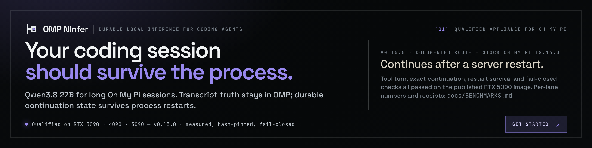
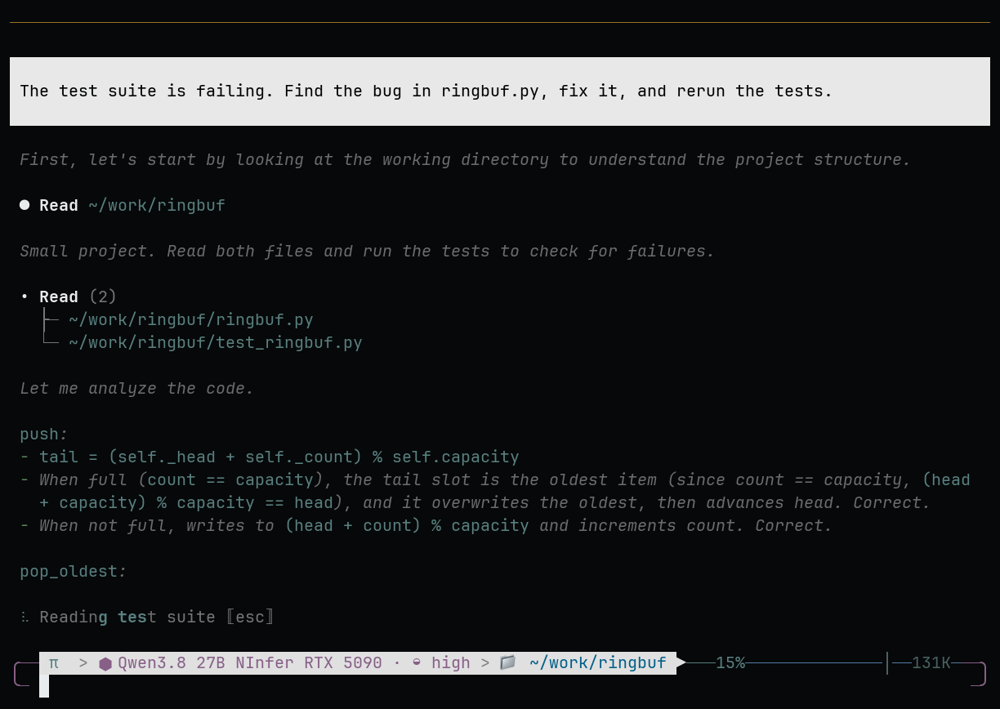
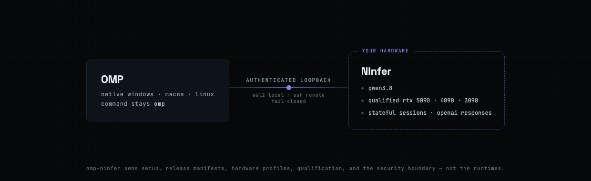
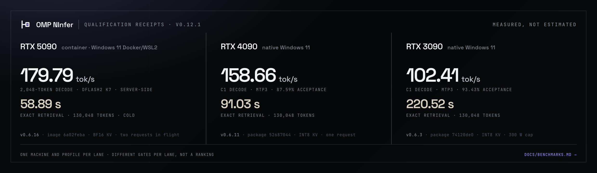

[][published-guide]

<div align="center">

[Oh My Pi](https://github.com/can1357/oh-my-pi) is the coding agent. [NInfer](https://github.com/Neroued/ninfer)
keeps your session's continuation state resident on your GPU. **OMP NInfer** is the qualified release
that binds them with one hash-pinned Qwen3.8 27B model on an RTX 5090, 4090, or 3090 you own.

Every install route in the guide was run end to end on **v0.13.0** with unmodified
[Oh My Pi 18.12.6](https://github.com/can1357/oh-my-pi/releases/tag/v18.12.6) — 31 steps,
three client platforms, both native lanes
([receipt](releases/v0.13.0/acceptance/composed-external-installation.json)).

### [Get started →][published-guide]

[![CI][ci-badge]][ci] [![Release][release-badge]][releases] [![RTX 5090 decode][decode-badge]][benchmarks] [![Context][context-badge]][benchmarks] [![License][license-badge]][license]

[Download v0.13.0](https://github.com/alphastorm/omp-ninfer/releases/tag/v0.13.0) · [Lanes][published-lanes] ·
[Facts](docs/FACTS.md) · [Compare](docs/DECISION_GUIDE.md) · [Benchmarks](docs/BENCHMARKS.md) ·
[Architecture](docs/ARCHITECTURE.md) · [Security](docs/SECURITY.md) · [Troubleshooting](docs/TROUBLESHOOTING.md) ·
[Roadmap](ROADMAP.md) · [Changelog](CHANGELOG.md)

</div>

[Contributor acceptance and doctor](docs/QUICKSTART.md#contributor-acceptance-and-preflight) run without GPU hardware in rehearsal/offline mode; rehearsal receipts never qualify a release.

[ci]: https://github.com/alphastorm/omp-ninfer/actions/workflows/ci.yml
[ci-badge]: https://img.shields.io/github/actions/workflow/status/alphastorm/omp-ninfer/ci.yml?branch=main&label=CI&labelColor=0B0E11
[releases]: https://github.com/alphastorm/omp-ninfer/releases
[release-badge]: https://img.shields.io/github/v/release/alphastorm/omp-ninfer?filter=v*&label=release&color=8E7BE8&labelColor=0B0E11
[benchmarks]: docs/BENCHMARKS.md
[decode-badge]: https://img.shields.io/badge/RTX%205090%20decode-179.86%20tok%2Fs-8E7BE8?labelColor=0B0E11
[context-badge]: https://img.shields.io/badge/context-130%2C048%20tokens%20exact-1C232B?labelColor=0B0E11
[license]: LICENSE
[license-badge]: https://img.shields.io/github/license/alphastorm/omp-ninfer?color=1C232B&labelColor=0B0E11
[published-guide]: https://github.com/alphastorm/omp-ninfer/blob/v0.13.0/docs/QUICKSTART.md
[published-lanes]: https://github.com/alphastorm/omp-ninfer/blob/v0.13.0/docs/QUICKSTART.md#choose-your-lane
[published-client]: https://github.com/alphastorm/omp-ninfer/blob/v0.13.0/docs/QUICKSTART.md#omp-18126-client

## What it does

A long coding session is 100K tokens of transcript, thinking, tool calls, and images. Sent to a
cloud provider, every token is metered and every file leaves your machine. Sent to a stateless
local server, every turn re-sends the whole transcript. A live NInfer, llama.cpp, or vLLM process
already avoids recomputing an unchanged prefix while it stays up; that is prior art, and this
project does not claim it. What OMP NInfer adds is continuation you can rely on:

- **Explicit and durable.** Oh My Pi drives NInfer through stateful OpenAI Responses
  (`previous_response_id`); forks and rollback are qualified, and checkpoints restore after a server
  restart. Oh My Pi commits the transcript first, so losing retained state degrades to a replay,
  never a broken session.
- **Private and fail-closed.** Both endpoints bind loopback only, every request is
  bearer-authenticated, and model fallback is off: an unreachable GPU fails the turn instead of
  answering from a cloud model. This is acceptance-tested, not configured.
- **Exact and verifiable.** Model SHA-256, container digest and SBOM, native package and client
  checksums, and every qualification receipt are bound in one manifest;
  `python3 scripts/verify_release.py --require-ready` proves your clone is the qualified release.

<div align="center">



<sub>Recorded on v0.3.0 (RTX 5090): bug fixed, tests green, stateful follow-up. 15 s, idle gaps
compressed, no restart shown · <a href="docs/media/omp-ninfer-demo-v3.mp4">MP4</a> ·
<a href="docs/media/README.md#canonical-files">provenance</a></sub>

</div>

## Is it for you

**Use OMP NInfer when** you run Oh My Pi, own an RTX 5090, 4090, or 3090 on Windows 11, want
Qwen3.8 27B, and care about long private sessions that survive a server restart.

**Use something else when** you want a broad model catalog ([Ollama](https://ollama.com)), a
desktop GUI ([LM Studio](https://lmstudio.ai)), the widest hardware reach or Apple silicon
([llama.cpp](https://github.com/ggml-org/llama.cpp)), or multi-user throughput
([vLLM](https://github.com/vllm-project/vllm)). Candid comparison: [decision guide](docs/DECISION_GUIDE.md).

## Qualified lanes

| Lane | Host and client | What you get | Measured |
| --- | --- | --- | --- |
| **RTX 5090** | Windows 11 + Docker Desktop/WSL2 container; Windows client local, macOS over a manual SSH tunnel (preview), Linux client under WSL2 | 131,072-token context, two requests in flight, DFlash2 draft window 7, JSON-schema output, vision + tools + preserved thinking | 179.86 tok/s decode; exact 130,048-token retrieval in 56.99 s cold ([receipt](releases/v0.13.0/qualification/rtx5090.json)) |
| **RTX 4090** | Native Windows 11 package; Windows client local | 131,072-token context, one request at a time, MTP3, text + tools | 158.66 tok/s C1 decode; exact 130,048-token retrieval in 91.03 s ([receipt](releases/v0.13.0/qualification/rtx4090.json)) |
| **RTX 3090** | Native Windows 11 package; Windows client local | 131,072-token context, one request at a time, MTP3, 300 W serving cap, text + tools | 102.41 tok/s C1 decode; exact 130,048-token retrieval in 220.52 s ([receipt](releases/v0.13.0/qualification/rtx3090.json)) |

Both native lanes install on one two-GPU host, each bound to its GPU UUID, and run one at a time on
port 18082; the RTX 5090 lane serves its own 20.4 GB model artifact and the native lanes share an
18.2 GB one. Checkpoints are best effort and restore only on the same runtime, model, profile, and
credentials. Exact component, source, and model identities: [facts](docs/FACTS.md#current-release) ·
[manifest](releases/v0.13.0/manifest.json).

## Get started

1. **[Choose your lane][published-lanes]** and check its prerequisites.
2. **Clone tag `v0.13.0`** and run `python3 scripts/verify_release.py --require-ready`.
3. **[Install the stock Oh My Pi 18.12.6 client][published-client]** with the
   fail-closed config and per-model fragment.
4. **Run the acceptance checks** at the end of your lane's route: tool turn, continuation, restart
   survival, fail closed.

Upgrading from v0.12.2 on RTX 5090 moves the container runtime onto upstream master `64d10fbf`
(`v0.7.0-qwen38-5090-beta.2`), published model container version 3 (`qwen3_8_27b-v3.ninfer`,
`81f924d4`), and isolated schema 3 checkpoint directory `checkpoints-v013` (keep `checkpoints`
for rollback; prior sessions replay from OMP transcripts); the native RTX 4090 and RTX 3090
packages carry unchanged from v0.12.2 and update only the stock Oh My Pi 18.12.6 client. Native
owners staying on v0.10.0 keep the [v0.10.0 guide](https://github.com/alphastorm/omp-ninfer/blob/v0.10.0/docs/QUICKSTART.md).

### Next release: rebased native Windows lanes

The [v0.13.1 draft](releases/v0.13.1/NINFER_RELEASE_NOTES.md) moves both native lanes onto upstream
master `64d10fbf`, the shared published version 3 model, strict-origin schema 3 checkpoints and
shared Host budgets, with 640/768 MiB admission headroom. The RTX 5090 beta.2 runtime and stock
OMP 18.12.6 carry unchanged. Both native beta.2 packages are published and freshly qualified,
including Chat/Responses JSON-schema output and 128-character tool names. Changed-source council
and fresh candidate-bound public-route acceptance remain separate gates in the
[draft qualification](releases/v0.13.1/qualification.json); this is not a published product.
The front-door links above stay on the accepted v0.13.0 guide while the working-tree guide stages
the next native model/download contract.

## How it works



Oh My Pi (coding-agent client) → OMP NInfer (qualified appliance and release layer) → NInfer
(inference engine) → Qwen3.8 27B (served model).

- **Oh My Pi owns the truth.** Transcript, tools, branches, and replay. A turn advances provider
  state only after a complete stream and a durable transcript write.
- **NInfer owns inference and retained state.** The C++/CUDA engine from
  [Neroued/ninfer](https://github.com/Neroued/ninfer) and its GPU ports, plus this project's
  explicit Responses state and checkpoints. Retained state accelerates; it is never the source of truth.
- **The manifest owns identity.** [`releases/v0.13.0/manifest.json`](releases/v0.13.0/manifest.json)
  binds client, runtime, model, profile, and receipts; `ready` requires composed external acceptance.

[Architecture](docs/ARCHITECTURE.md) · [Security model](docs/SECURITY.md) ·
[Release lifecycle](docs/RELEASES.md)

## Measured, not estimated



Each lane is measured on its own gate, machine, and profile; the strip is not a ranking. Method,
per-lane charts, the warm-versus-cold boundary rules, model quality, and the community table:
[benchmarks](docs/BENCHMARKS.md).

## Release integrity

```sh
python3 scripts/verify_release.py --require-ready
python3 -m unittest discover -s tests -v
```

Both pass on a tagged release. A `ready` manifest binds the upstream Oh My Pi binaries,
compatibility matrix, container digest and SBOM or native package checksums, lane-specific model
SHA-256, per-lane qualification receipts, and owner-operated acceptance of every documented route.
Lifecycle and cut rules: [releases](docs/RELEASES.md).

## Documentation

| Document | What it answers |
| --- | --- |
| [Published quickstart][published-guide] | Which lane, prerequisites, exact install, acceptance checks |
| [Facts](docs/FACTS.md) | Current identities, limits, and non-claims in one place |
| [Decision guide](docs/DECISION_GUIDE.md) | This versus Ollama, LM Studio, llama.cpp, vLLM |
| [Compatibility](docs/COMPATIBILITY.md) | Qualified client and runtime combinations (generated) |
| [Architecture](docs/ARCHITECTURE.md) | State ownership, loopback topology, identity chain |
| [Benchmarks](docs/BENCHMARKS.md) | Receipts, method, charts, model quality, community results |
| [Performance](docs/PERFORMANCE.md) | Kernel and schedule experiment ledger (`EXP-001`..`EXP-097`) |
| [Security](docs/SECURITY.md) | Threat model and boundaries |
| [Troubleshooting](docs/TROUBLESHOOTING.md) | Failure signatures and recovery |
| [Related work](docs/RELATED_WORK.md) | Prior art and the NInfer port family |
| [Upstream](docs/UPSTREAM.md) | Upstream watch and fork points |
| [Releases](docs/RELEASES.md) | Version history and how a release is cut |
| [Roadmap](ROADMAP.md) | Remaining work and explicit non-promises |
| [Changelog](CHANGELOG.md) | What changed, per release |
| [Media provenance](docs/media/README.md) | Checksums and capture notes for every recording |

## Help make it better

- **Ran a clean install?** Report
  [time-to-first-turn and every manual step](https://github.com/alphastorm/omp-ninfer/issues/new?template=clean-install-report.yml);
  install friction is a bug.
- **Measured your card?** Submit the
  [performance result form](https://github.com/alphastorm/omp-ninfer/issues/new?template=benchmark-report.yml)
  after the acceptance checks pass.
- **Work on CUDA kernels?** Pick a bottleneck from the [performance program](docs/PERFORMANCE.md)
  and send before/after receipts.
- **Need another model or profile?** File a
  [model/profile request](https://github.com/alphastorm/omp-ninfer/issues/new?template=model-profile-request.yml).

Routing rules: [CONTRIBUTING.md](CONTRIBUTING.md). Strip keys, hostnames, prompts, outputs, and raw
logs before filing. Support covers `v0.13.0` and its exact profiles for a single local owner; no SLA.
Vulnerabilities: [private reporting](SECURITY.md), never a public issue.

## Credits

- **[Oh My Pi](https://github.com/can1357/oh-my-pi)** by [can1357](https://x.com/_can1357), built
  on [Pi](https://github.com/badlogic/pi-mono) by Mario Zechner (MIT). The coding agent this
  appliance serves; since v0.8.0 the client is the unmodified upstream binary and this project
  publishes no client.
- **[NInfer](https://github.com/Neroued/ninfer)** by Neroued (Apache-2.0). The C++/CUDA engine,
  `.ninfer` format, MTP and DFlash2 speculative decoding, and evaluation campaigns. Public runtime
  source for all three lanes: [alphastorm/ninfer](https://github.com/alphastorm/ninfer).
- **The Qwen team** (Apache-2.0). Qwen3.8 27B, served from the registered conversions at
  [neroued/Qwen3.8-27B-NInfer](https://huggingface.co/neroued/Qwen3.8-27B-NInfer).
- **[UDPSendToFailed/ninfer-4090](https://github.com/UDPSendToFailed/ninfer-4090)** and
  **[Don-Chad/ninfer-3090](https://github.com/Don-Chad/ninfer-3090)** (Apache-2.0). The RTX 4090 and
  RTX 3090 ports the native lanes build on.
- Gated DeltaNet ([arXiv: 2412.06464](https://arxiv.org/abs/2412.06464)), Tri Dao's ReplaySSM note,
  Z-Lab's DFlash, Unsloth's NVFP4 weights, and vendored `utf8proc`, `nlohmann/json`, and
  `cpp-httplib`; tracked in [upstream](docs/UPSTREAM.md).

Community project; not affiliated with or endorsed by Oh My Pi, Qwen, or NVIDIA.

## License

MIT. NInfer and the Qwen artifacts retain their own licenses and notices.
