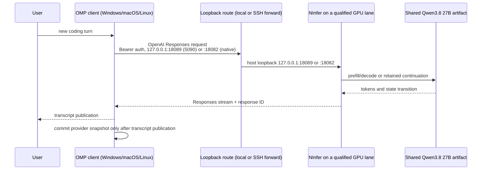

# Architecture

Oh My Pi (coding-agent client) → OMP NInfer (qualified appliance and release layer) → NInfer
(inference engine) → Qwen3.8 27B (served model).

OMP NInfer is an integration and release product, not a third inference runtime. Oh My Pi (OMP)
owns the session transcript and tools, while NInfer owns in-memory and checkpointed continuation
state over a bearer-authenticated loopback route. Each release binds a client, runtime, shared
model, hardware profile, topology, and qualification summary
([current release facts](FACTS.md#current-release)).

## Runtime topology

Every listener endpoint is loopback-only:

- **RTX 5090 container lane (`127.0.0.1:18089`):** On Windows 11 with Docker Desktop and WSL2,
  `examples/manual-tunnel/start-ninfer.sh` runs `ninfer-serve` on `0.0.0.0:8080` inside Docker
  `bridge` container `omp-ninfer-beta` with `--restart no`, `--cap-drop ALL`, `no-new-privileges`,
  and the hash-pinned `io_uring` seccomp profile
  `examples/manual-tunnel/ninfer_io_uring_seccomp.json`, and Docker publishes that port to host
  loopback (`--publish 127.0.0.1:18089:8080`). Docker `--network host` is not used because on
  Docker Desktop it binds inside the utility VM rather than the Windows and WSL2 host loopback.
  Local Windows and WSL2 Linux clients reach `http://127.0.0.1:18089/v1` directly; on macOS
  (preview), `examples/manual-tunnel/open-tunnel.sh` forwards Mac loopback to the RTX 5090 host
  loopback (`-L 127.0.0.1:18089:127.0.0.1:18089`, `ExitOnForwardFailure=yes`). Each release writes
  checkpoints to its own host directory while the container mount path stays the one its profile
  fixes, with `--session-checkpoint-require-origin-auth`.
- **Native Windows RTX 4090 and RTX 3090 lanes (`127.0.0.1:18082`):** Both packages install on one
  two-GPU Windows 11 host under `%ProgramData%\NInfer\qwen38-4090-native` and
  `%ProgramData%\NInfer\qwen38-3090-native`, binding each card by GPU UUID (`Control-GpuOwner.ps1`)
  rather than ordinal. Both share `http://127.0.0.1:18082/v1` and run one lane at a time, never as
  multi-GPU or simultaneous serving. Under its state root, each installed release writes
  checkpoints to `cache/<release-instance-id>/session-checkpoints-v3` with
  `--session-checkpoint-require-origin-auth`. Managed stop (`Control-Release.ps1 -Action Stop`)
  signals `stop-event` (900 s graceful wait), flushes live sessions to checkpoints, writes
  `last-stop.json`, releases the GPU lease, and on RTX 3090 restores the default power limit from
  its serving cap.
- **Shared model artifact (`components.model`):** All three lanes serve one hash-pinned Qwen3.8 27B
  `.ninfer` artifact (`huggingface.co/neroued/Qwen3.8-27B-NInfer`) with
  [DFlash2](FACTS.md#glossary) speculative decoding (draft window 7), tools, JSON-schema output,
  and preserved thinking. Only the RTX 5090 lane serves vision; native lanes disable vision.
  Per-lane limits and checkpoint paths are in [lanes and limits](FACTS.md#lanes-and-limits).

Where SSH is used, it authenticates the machine path; a separate bearer token authenticates every
HTTP endpoint (key paths and permissions are in the
[security model](SECURITY.md#release-invariants)). All three lanes write authenticated,
session-scoped checkpoints to local storage and restore the prior Responses chain after a restart;
OMP's transcript remains authoritative if retained state is absent or invalid.

## State ownership

- **OMP transcript:** authoritative messages, tool calls and results, branches, and history.
- **OMP provider snapshot:** private acceleration envelope holding the committed NInfer response
  baseline and identity needed to append the next turn.
- **NInfer Responses state:** retained response and cache state scoped by authenticated client and
  session identity, with durable checkpoints for restart recovery on all three lanes.
- **Qwen artifact:** immutable model bytes pinned by revision, size, and SHA-256.

A turn advances provider state only after a complete valid stream and durable transcript
publication. Cancellation, malformed or incomplete output, transport failure, or transcript
persistence failure leaves the prior committed baseline usable. If acceleration state is absent or
invalid, OMP's transcript is sufficient for a full replay.

This is why no stateful gateway sits between OMP and NInfer. A gateway would create a second owner
for continuation, persistence, and failure recovery.

## Checkpoint transport

`scripts/checkpoint_sync.py` exports verified published generations to replica storage and imports
them into a local checkpoint root before restore; the live runtime never serves a network share.
Host-to-host copy and NAS replication check payload hashes, and the runtime authenticates
`manifest.mac`. Restore requires the matching runtime binary, model, profile, and bearer-bound
session identity. The recorded recovery probes return state to its original lane, not to a second
inference host or a different GPU
([checkpoint transport and NAS replication](FACTS.md#checkpoint-transport-and-nas-replication)).

## Identity chain

Each release manifest (linked from the [current release facts](FACTS.md#current-release)) binds:

1. product release and support channel;
2. upstream OMP source revision, platform binaries, byte counts, and SHA-256 pins;
3. primary RTX 5090 NInfer source, server binary, OCI digest, and SBOM plus each UUID-bound native
   variant package, source archive, SPDX and CycloneDX dependency SBOMs, installer and controller
   scripts, configuration, and qualification receipt;
4. the shared Qwen3.8 27B model artifact (`components.model`) by revision, byte count, and SHA-256;
5. canonical runtime configuration hash, seccomp profile hash, and hardware profile; and
6. the public product qualification summary and composed external-installation result.

Manifest status uses three states
([release state transition](RELEASES.md#release-state-transition)). `draft` permits incomplete
publication fields and requires explicit blockers. `candidate` requires every installable component
identity and retains the external-install blocker. `ready` adds an exact qualification-summary
hash, an external-install pass, and zero blockers (`scripts/verify_release.py --require-ready`).

The manifest is authoritative over README examples, mutable container tags, and branch names.
Release images are consumed only by `@sha256:` digest.

## Component boundaries

### `omp-ninfer`

Owns product naming, release and profile contracts, setup and support paths, public qualification
composition, and cross-component pins. It does not own model mathematics, CUDA kernels, OMP session
semantics, or a request proxy.

### Oh My Pi

Owns the coding-agent interface, transcript, tools, and model configuration. Each release pins
unmodified upstream [Oh My Pi](https://github.com/can1357/oh-my-pi) binaries by byte count and
SHA-256 across Windows x64, macOS arm64 (preview), and Linux x64 under WSL2. Each model entry sets
`compat.statefulResponses: true` (`previous_response_id` and `prompt_cache_key`) with
`PI_OPENAI_STATEFUL` unset. Applying `examples/manual-tunnel/fail-closed.yml` disables retries,
cloud fallback, and automatic updates while bounding requests via `providers.maxInFlightRequests`.
Stock Oh My Pi has no runtime installer or lifecycle subcommands, and this repository builds and
publishes no Oh My Pi binary ([version identities](RELEASES.md#version-identities)).

### NInfer

Owns the `.ninfer` engine and server, CUDA execution, Qwen3.8 runtime, Responses state and
checkpoint store, authenticated status endpoint, numerical behavior, container and native packages,
and runtime qualification. The RTX 5090 image and UUID-bound native Windows RTX 4090 and RTX 3090
packages are published under [`alphastorm/ninfer`](https://github.com/alphastorm/ninfer) from
upstream [`Neroued/ninfer`](https://github.com/Neroued/ninfer), keeping separate lane contracts.

## Lifecycle routes

Install, upgrade, stop, and rollback follow the container scripts and native Windows controllers in
the [Quickstart](QUICKSTART.md). OMP remains the transcript and coding-agent interface owner.

Community project; not affiliated with or endorsed by Oh My Pi, Qwen, or NVIDIA.
