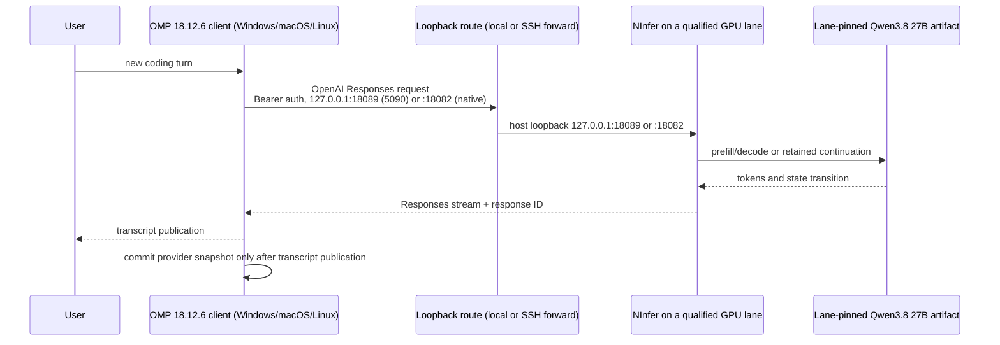

# Architecture

Oh My Pi (coding-agent client) → OMP NInfer (qualified appliance and release layer) → NInfer
(inference engine) → Qwen3.8 27B (served model).

OMP NInfer is an integration and release product, not a third inference runtime. Each published
release (`v0.13.1`) binds an exact Oh My Pi (OMP) client, NInfer runtime, shared Qwen3.8 27B
artifact, hardware profile, loopback topology, and qualification summary.

## Runtime topology

Every listener endpoint is loopback-only:

- **RTX 5090 container lane (`127.0.0.1:18089`):** On Windows 11 with Docker Desktop and WSL2,
  `examples/manual-tunnel/start-ninfer.sh` runs `ninfer-serve` on `0.0.0.0:8080` inside a Docker
  `bridge` container (`omp-ninfer-beta`, `--restart no`, `--cap-drop ALL`, `no-new-privileges`, and
  the hash-pinned `io_uring` seccomp profile `examples/manual-tunnel/ninfer_io_uring_seccomp.json`)
  and publishes that port to the runtime host's loopback (`--publish 127.0.0.1:18089:8080`). Docker
  host networking is not used because `--network host` on Docker Desktop binds inside the utility VM
  rather than the Windows and WSL2 host loopback. A local Windows client reaches
  `http://127.0.0.1:18089/v1` directly; on the macOS preview route,
  `examples/manual-tunnel/open-tunnel.sh` opens a manual SSH local forward
  (`-L 127.0.0.1:18089:127.0.0.1:18089`, `ExitOnForwardFailure=yes`) from Mac loopback to remote
  loopback. The profile (`qwen38-5090-v0.13.0`, configuration `751d22dc`; carried from `v0.13.0`) admits up to two requests
  in flight (`--max-concurrency 2`, `--device-state-slots 2`, `--pending-timeout-ms 180000`,
  `--session-checkpoint-require-origin-auth`) over an automatic 146,368-token BF16 device KV pool
  and a shared 20,867.734375 MiB (21,881,405,440-byte) Host context budget, mounting
  `/checkpoints-v013` from host directory `checkpoints-v013`.
- **Native Windows RTX 4090 and RTX 3090 lanes (`127.0.0.1:18082`):** Both native packages
  (`v0.7.0-qwen38-4090-beta.2` and `v0.7.0-qwen38-3090-beta.2`, source `7a25cd72` on upstream
  `Neroued/ninfer` master `64d10fbf`) install on one two-GPU Windows 11 host under
  `%ProgramData%\NInfer\qwen38-4090-native` and `%ProgramData%\NInfer\qwen38-3090-native`. Each
  installer binds its card by GPU UUID (`Control-GpuOwner.ps1`) rather than device ordinal. Both
  lanes share `http://127.0.0.1:18082/v1` and run sequentially, one lane at a time and one request
  in flight (`concurrency: 1`, 30 s pending timeout, INT8 KV, MTP3 with `--lm-head-draft`, mandatory
  `--session-checkpoint-require-origin-auth`, release-isolated schema 3 checkpoint directory
  `cache/<release-instance-id>/session-checkpoints-v3` where `<release-instance-id>` is the
  installed release ID such as `qwen38-4090-native-v0.7.0-beta.2-7a25cd72f490`, `14,787.734375 MiB` /
  `15,506,063,360-byte` shared Host budget with `640 MiB` admission headroom and two extra
  device-state slots on RTX 4090, and `11,715.734375 MiB` / `12,284,837,888-byte` shared Host
  budget with `768 MiB` admission headroom and four extra device-state slots on RTX 3090). This is
  not multi-GPU inference or concurrent native serving. A managed stop
  (`Control-Release.ps1 -Action Stop`) signals `stop-event` (900 s graceful wait), flushes live
  sessions to checkpoints, records the stop in `last-stop.json`, releases the GPU lease, and on the
  RTX 3090 restores the default 370 W power limit from its 300 W serving cap.
- **Shared model artifact (`components.model`):** All three lanes serve the same registered Qwen3.8
  27B model container version 3 `.ninfer` artifact from `huggingface.co/neroued/Qwen3.8-27B-NInfer`
  at pinned revision `1cbd84e7` (`81f924d4`, 20,437,521,664 bytes, downloaded to
  `qwen3_8_27b-v3.ninfer`; the RTX 5090 container lane enables vision, tools, DFlash2 K=7,
  JSON-schema output, and preserved thinking, while the native Windows RTX 4090 and RTX 3090 lanes
  serve text, tools, JSON-schema output, and preserved thinking under MTP3 with vision disabled).

SSH (where used) authenticates the machine path; a separate bearer token always authenticates the
HTTP endpoint (`~/.config/omp-ninfer/api-key` mounted at `/run/secrets/ninfer_api_key` for the
container, `~/.omp/agent/ninfer-beta.key` on clients, and `%ProgramData%\omp-ninfer-keys\api-key.txt`
for native lanes). All three lanes write authenticated, session-scoped checkpoints to local storage
and restore the prior Responses chain after a server restart. OMP's transcript remains
authoritative if any retained state is absent or invalid.

## State ownership

- **OMP transcript:** authoritative messages, tool calls/results, branches, and session history.
- **OMP provider snapshot:** a private acceleration envelope containing the committed NInfer response
  baseline and identity needed to append the next turn.
- **NInfer Responses state:** retained response/cache state scoped by authenticated client and
  session identity, with durable checkpoints for restart recovery on all three lanes.
- **Qwen artifact:** immutable model bytes pinned by revision, size, and SHA-256.

A turn advances provider state only after a complete valid stream and durable transcript publication.
Cancellation, malformed/incomplete output, transport failure, or transcript persistence failure must
leave the prior committed baseline usable. If acceleration state is absent or invalid, OMP's
transcript remains sufficient for a full replay.

This is why another stateful gateway is not inserted between OMP and NInfer. It would create a second
owner for continuation, persistence, and failure recovery without solving a first-release problem.

## Checkpoint transport

`scripts/checkpoint_sync.py` exports verified published generations to replica storage and
imports them into a local checkpoint root before restore. Host-to-host copying and NAS
replication are implemented; the live runtime never serves a network-share checkpoint root.
Sync checks payload hashes; the runtime authenticates `manifest.mac`. Restore requires the
matching runtime binary, model, profile, and bearer-bound session identity. The recorded
recovery probes return state to its original lane, not a second inference host or different GPU.
See [operator guidance and receipts](FACTS.md#checkpoint-transport-and-nas-replication).

## Identity chain

The [published release manifest](../releases/v0.13.1/manifest.json) binds:

1. product release and support channel;
2. upstream OMP 18.12.6 source revision, platform binaries, byte counts, and SHA-256 pins;
3. primary RTX 5090 NInfer source, server binary, OCI digest, and SBOM plus each UUID-bound native
   variant package, source archive, SPDX and CycloneDX dependency SBOMs, installer/controller
   scripts, configuration, and qualification receipt;
4. the shared Qwen3.8 27B model container version 3 artifact (`components.model`) by revision, byte
   count, and SHA-256;
5. canonical runtime configuration hash, seccomp profile hash, and hardware profile; and
6. the public product qualification summary and composed external-installation result.

`draft` permits incomplete publication fields and requires explicit blockers. `candidate` requires
every installable component identity and retains the external-install blocker. `ready` additionally
requires an exact qualification-summary hash, an external-install pass, and zero blockers.
`scripts/verify_release.py --require-ready` enforces the cut boundary.

The manifest is authoritative over README examples, mutable container tags, and
branch names. Release images are consumed only by `@sha256:` digest.

## Component boundaries

### `omp-ninfer`

Owns product naming, release/profile contracts, setup and support paths, public qualification
composition, and cross-component version pins. It does not own model mathematics, CUDA kernels,
OMP session semantics, or another request proxy.

### OMP

Owns the coding-agent UX, transcript, tools, and model configuration. The client is unmodified
[upstream Oh My Pi 18.12.6](https://github.com/can1357/oh-my-pi/releases/tag/v18.12.6) (source
`45c35e40c46166dc726ccc52f5d27f40f2449f99`), pinned by byte count and SHA-256 across Windows x64,
macOS arm64 (preview), and Linux x64 (WSL2). Each NInfer model entry sets
`compat.statefulResponses: true` for OpenAI Responses chaining (`previous_response_id` and
`prompt_cache_key`) with `PI_OPENAI_STATEFUL` unset, and `examples/manual-tunnel/fail-closed.yml`
disables retries and cloud fallback while bounding per-provider concurrency via
`providers.maxInFlightRequests`. Stock OMP includes no built-in runtime installer or lifecycle
subcommands. Through v0.7.4, a downstream fork and the `alphastorm/homebrew-omp` tap (private since
2026-10-02) distributed the client; this repository no longer builds or publishes an OMP binary
(see [release history](RELEASES.md#version-identities)).

### NInfer

Owns the `.ninfer` engine and server, CUDA execution, Qwen3.8 runtime, Responses state and
checkpoint store, authenticated status, numerical behavior, container and native packages, and
runtime qualification. The RTX 5090 container runtime (`v0.7.0-qwen38-5090-beta.2`, source
`6d4d0a05` on upstream `Neroued/ninfer` master `64d10fbf`, carried from `v0.13.0`) and the UUID-bound native Windows
RTX 4090 (`v0.7.0-qwen38-4090-beta.2`) and RTX 3090 (`v0.7.0-qwen38-3090-beta.2`) packages (source
`7a25cd72` on upstream `Neroued/ninfer` master `64d10fbf`) are published under
[alphastorm/ninfer](https://github.com/alphastorm/ninfer), retaining their upstream lineage and
separate hardware contracts.

## Lifecycle routes

Install, upgrade, stop, and rollback follow the documented container scripts and native Windows
controllers in the [Quickstart](QUICKSTART.md). OMP remains the transcript and coding-agent UX
owner.
